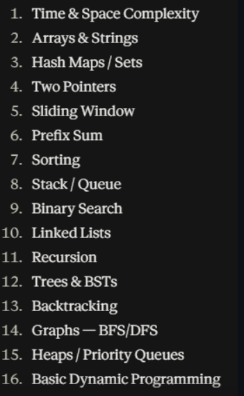

# Problem_solving
to use the template enter lc + enter

<!---LeetCode Topics Start-->
# LeetCode Topics
## Array
|  |
| ------- |
| [0026-remove-duplicates-from-sorted-array](https://github.com/ahmedliouane0/Problem_solving/tree/master/0026-remove-duplicates-from-sorted-array) |
## Two Pointers
|  |
| ------- |
| [0026-remove-duplicates-from-sorted-array](https://github.com/ahmedliouane0/Problem_solving/tree/master/0026-remove-duplicates-from-sorted-array) |
| [0344-reverse-string](https://github.com/ahmedliouane0/Problem_solving/tree/master/0344-reverse-string) |
| [1332-remove-palindromic-subsequences](https://github.com/ahmedliouane0/Problem_solving/tree/master/1332-remove-palindromic-subsequences) |
| [2000-reverse-prefix-of-word](https://github.com/ahmedliouane0/Problem_solving/tree/master/2000-reverse-prefix-of-word) |
## String
|  |
| ------- |
| [0344-reverse-string](https://github.com/ahmedliouane0/Problem_solving/tree/master/0344-reverse-string) |
| [1332-remove-palindromic-subsequences](https://github.com/ahmedliouane0/Problem_solving/tree/master/1332-remove-palindromic-subsequences) |
| [2000-reverse-prefix-of-word](https://github.com/ahmedliouane0/Problem_solving/tree/master/2000-reverse-prefix-of-word) |
## Math
|  |
| ------- |
| [0009-palindrome-number](https://github.com/ahmedliouane0/Problem_solving/tree/master/0009-palindrome-number) |
## Stack
|  |
| ------- |
| [2000-reverse-prefix-of-word](https://github.com/ahmedliouane0/Problem_solving/tree/master/2000-reverse-prefix-of-word) |
<!---LeetCode Topics End-->